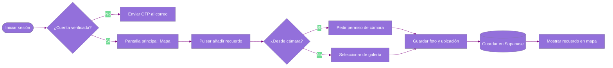
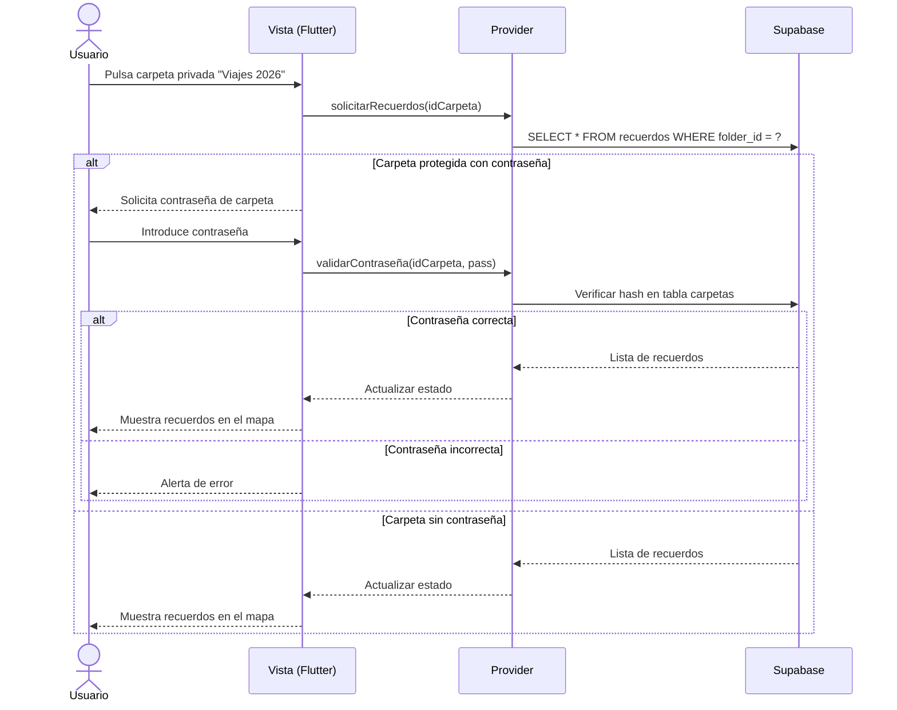
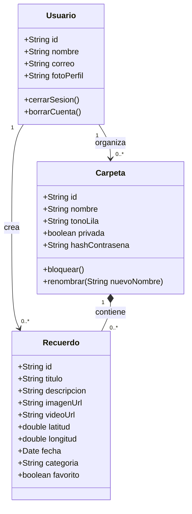
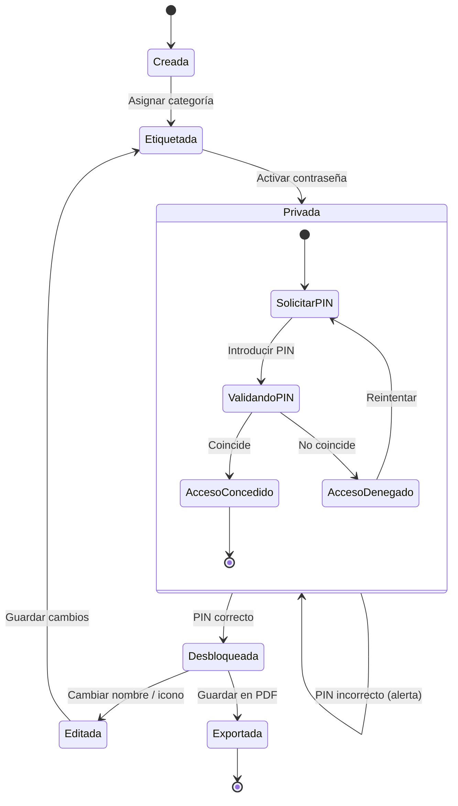

<div align="center">
  <h1>NaYeKa Memories</h1>
  <p><b>Aplicación móvil y web para guardar recuerdos geolocalizados en un mapa interactivo</b></p>
  <p><i>Proyecto intermodular - DAM - 2026</i></p>
</div>

---

<a id="indice"></a>
# Índice

* [1. Descripción del proyecto](#descripcion-del-proyecto)
* [2. Arquitectura y stack tecnológico](#arquitectura-y-stack-tecnologico)
* [3. Diseño de interfaz y estética visual](#diseno-de-interfaz-y-estetica-visual)
* [4. Métricas y modelos matemáticos](#metricas-y-modelos-matematicos)
* [5. Diagramas del sistema](#diagramas-del-sistema)
* [6. Instalación, uso y código](#instalacion-uso-y-codigo)
* [7. Planificación](#planificacion)
* [8. Referencias y citas](#referencias-y-citas)

---

<a id="descripcion-del-proyecto"></a>
# 1. Descripción del proyecto — [Volver al índice](#indice)

***NaYeKa Memories*** es el proyecto intermodular desarrollado durante el ciclo formativo de grado superior en *Desarrollo de Aplicaciones Multiplataforma (DAM)* por **Nayra, Yedra y Karen**.

Se trata de una aplicación móvil y web que permite a los usuarios guardar recuerdos en forma de fotografías y vídeos asociados a una ubicación real. Cada recuerdo incluye un título, una imagen, una descripción tipo diario, la fecha y su posición exacta en el mapa.

A diferencia de otras aplicaciones como Google Photos o Instagram, NaYeKa Memories ~~no se limita a almacenar fotos~~, sino que las **geolocaliza en un mapa interactivo**, las organiza en carpetas (algunas protegidas con contraseña) y permite exportarlas a PDF o compartirlas con otros usuarios.

> [!NOTE]
> **NaYeKa Memories** surge de una idea sencilla, tener juntos los apuntes, los viajes y los recuerdos en un solo lugar, pero organizados y con un estilo visual propio para encontrar cada cosa rápido y sin esfuerzo.


<sub>© 2026 NaYeKa Memories🌸 · Proyecto intermodular DAM · Desarrollado por Nayra, Yedra y Karen 
</sub>

---

<a id="arquitectura-y-stack-tecnologico"></a>
# 2. Arquitectura y stack tecnológico — [Volver al índice](#indice)

## 2.1. Capas del sistema

El desarrollo sigue un patrón de arquitectura basado en **Providers**, lo que permite una separación clara entre la interfaz de usuario y la lógica de negocio. El código se organiza en la siguiente estructura de directorios:

1. **Capa de Presentación (UI):**
   * Pantallas principales de la interfaz (`screens`): login, home, map, galería, perfil.
   * Componentes visuales reutilizables (`widget`).
   * Definición de colores, estilos y recursos compartidos (`constants`).
2. **Capa de Lógica de Negocio:**
   * Gestión del estado de la aplicación y comunicación entre pantallas (`providers`).
   * Modelo de datos de los recuerdos, serialización y utilidades lógicas (`models`).
3. **Capa de Persistencia y Servicios:**
   * Conexión directa con APIs externas, generación y exportación de PDF y **Supabase** (`services`).
   * Almacenamiento híbrido: base de datos PostgreSQL en Supabase + almacenamiento de archivos (Storage).

## 2.2. Comparativa de tecnologías utilizadas

| Característica | Flutter (Frontend) | Supabase (Backend) | Google Maps (Geolocalización) |
| :--- | :---: | :---: | ---: |
| **Función principal** | Interfaz multiplataforma | Autenticación, base de datos y Storage | Visualización de recuerdos en mapa |
| **Lenguaje / Base** | Dart | PostgreSQL | API de mapas |
| **Ventaja clave** | Un solo código para móvil y web | Código abierto y tiempo real | Precisión y fluidez |
| **Uso en NaYeKa Memories** | Toda la app | Datos, usuarios e imágenes | Mapa interactivo de recuerdos |

---

<a id="diseno-de-interfaz-y-estetica-visual"></a>
# 3. Diseño de interfaz y estética Visual — [Volver al índice](#indice)

### 3.1. Identidad cromática y de marca

El nombre **NaYeKa** está formado por las iniciales de sus tres creadoras:

* **Na** de Nayra
* **Ye** de Yedra
* **Ka** de Karen
* **Memories**, haciendo referencia a los recuerdos que se almacenan en la aplicación

El logotipo representa la idea de memoria y ubicación, combinando elementos de mapa y fotografía. La interfaz apuesta por **un diseño limpio, moderno y visual**, con una paleta de colores suave y coherente que se adapta tanto al modo claro como al modo oscuro. Asimismo, los iconos de las acciones principales mantienen un estilo unificado y reconocible, evitando la saturación visual y facilitando la navegación.

### 3.2. Galería del proyecto (Imágenes locales y externas)

<!-- Imágenes externas desde Internet -->
<p align="center">
  
  
</p>

<!-- Imágenes locales reales del repositorio -->
> **Logotipo oficial de NaYeKa Memories (Archivo local del repositorio):**  
> 

> **Ejemplo de recuerdo almacenado (Archivo local del repositorio):**  
> 

| Elemento Visual | Archivo Local | Descripción | Formato |
| :--- | :---: | :--- | ---: |
| **Logotipo Principal** | `./assets/images/logo.png` | Identidad visual de NaYeKa Memories | `PNG` |
| **Icono de Ubicación** | `./assets/icons/location.png` | Marcador utilizado en el mapa interactivo | `PNG` |
| **Muestra de Recuerdo** | `./assets/images/memory3.jpg` | Imagen de prueba integrada en el proyecto | `JPG` |

---


<a id="metricas-y-modelos-matematicos"></a>
# 4. Métricas y modelos matemáticos — [Volver al índice](#indice)

Para calcular las estadísticas de viaje, posicionar los recuerdos en el mapa y gestionar el almacenamiento, **NaYeKa Memories** utiliza fórmulas matemáticas de distintos ámbitos:

### 4.1. Distancia aproximada entre dos recuerdos (Geometría)

Para calcular la distancia $d$ en línea recta entre dos ubicaciones con coordenadas $(x_1, y_1)$ y $(x_2, y_2)$ en el mapa, se aplica el teorema de Pitágoras:

$$d = \sqrt{(x_2 - x_1)^2 + (y_2 - y_1)^2}$$

### 4.2. Porcentaje de "Mis metas de viaje" (Porcentajes y Proporciones)

El porcentaje de progreso $P$ hacia el objetivo anual de lugares visitados ($M$) tras recorrer $v$ ubicaciones se calcula mediante:

$$P = \frac{v}{M} \times 100$$

### 4.3. Media mensual de recuerdos guardados (Estadística)

Para mostrar en el perfil de usuario la media $\bar{x}$ de recuerdos subidos a lo largo de los $12$ meses del año, se utiliza la media aritmética:

$$\bar{x} = \frac{1}{12} \sum_{i=1}^{12} x_i$$

### 4.4. Espacio libre en Supabase Storage (Aritmética y Restas)

Si cada cuenta cuenta con un límite total $E_{\text{total}} = 1024\text{ MB}$ y los archivos ocupan $E_{\text{usado}}$, el espacio disponible restante $E_{\text{libre}}$ viene dado por $E_{\text{libre}} = E_{\text{total}} - E_{\text{usado}}$.

### 4.5. Tamaño máximo permitido de vídeo (Desigualdades e Intervalos)

Para garantizar una carga rápida, la duración $t$ (en segundos) de los vídeos subidos debe cumplir la siguiente condición:

$$0 < t \leq 30$$

### 4.6. Total de recuerdos almacenados (Suma básica)

El número total de recuerdos $T$ de un usuario se calcula sumando los recuerdos guardados en carpetas públicas ($P$) y en carpetas privadas ($C$):

$$T = P + C$$

---

<a id="diagramas-del-sistema"></a>
# 5. Diagramas del Sistema — [Volver al índice](#indice)

## 5.1. Diagrama de flujo: Proceso de creación de un recuerdo



## 5.2. Diagrama de secuencia: Apertura de una carpeta privada



## 5.3. Diagrama de clases: Modelo de datos



## 5.4. Diagrama de estados: Ciclo de vida de una carpeta



---

<a id="instalacion-uso-y-codigo"></a>
# 6. Instalación, uso y codigo — [Volver al índice](#indice)

> [!WARNING]
> **Importante antes de ejecutar:** Asegúrate de tener instalado **Flutter (versión estable)** y configuradas las claves de **Supabase** y **Google Maps** en los archivos de configuración. Sin estas claves, la app no podrá conectar con la base de datos ni mostrar el mapa.

### 6.1. Clonar el repositorio

Ejecuta el siguiente comando en tu terminal (`bash` o `zsh`):

```bash
git clone https://github.com/yedraalumna/NaYeKa_memories.git
cd NaYeKa_memories
flutter pub get
flutter run
```

### 6.2. Ejemplo de implementación en Dart (gestión de recuerdos)

Fragmento del modelo `Recuerdo` donde se gestionan los datos geolocalizados:

```dart
class Recuerdo {
  final String id;
  final String titulo;
  final String descripcion;
  final String imagenUrl;
  final double latitud;
  final double longitud;
  final DateTime fecha;
  final String categoria;
  final bool favorito;

  Recuerdo({
    required this.id,
    required this.titulo,
    required this.descripcion,
    required this.imagenUrl,
    required this.latitud,
    required this.longitud,
    required this.fecha,
    this.categoria = 'General',
    this.favorito = false,
  });

  Map<String, dynamic> toMap() => {
        'id': id,
        'titulo': titulo,
        'descripcion': descripcion,
        'imagen_url': imagenUrl,
        'latitud': latitud,
        'longitud': longitud,
        'fecha': fecha.toIso8601String(),
        'categoria': categoria,
        'favorito': favorito,
      };
}
```

### 6.3. Consulta SQL de ejemplo en Supabase

```sql
CREATE INDEX idx_recuerdo_fecha ON recuerdos (fecha DESC);
SELECT id, titulo, latitud, longitud, categoria
FROM recuerdos
WHERE favorito = true
ORDER BY fecha DESC;
```

---

<a id="planificacion"></a>
# 7. Planificación — [Volver al índice](#indice)

### 7.1. Lista de tareas del proyecto (Checklist)

- [x] Crear el proyecto en Flutter y conectarlo a GitHub.
- [x] Configurar Supabase para autenticación, base de datos y Storage.
- [x] Implementar CRUD completo de recuerdos (crear, leer, actualizar, eliminar).
- [x] Añadir Google Maps con marcadores personalizados.
- [x] Crear carpetas personalizadas y carpetas privadas con contraseña.
- [x] Implementar exportación de recuerdos a PDF.
- [x] Añadir estadísticas de viaje ("Mis metas de viaje").
- [x] Implementar correo de verificación con código OTP.
- [x] Añadir modo claro / modo oscuro.
- [ ] Sincronización automática en la nube (previsto para v3.0).
- [ ] Añadir funciones sociales (comentarios y reacciones).

### 7.2. Resumen de tareas por semana

| Semana | Tarea principal | Responsable | Estado |
| :--- | :--- | :---: | ---: |
| 1-2 | Crear proyecto y conectar GitHub | Yedra | Completado |
| 1-2 | Configurar Supabase | Nayra | Completado |
| 1-2 | Modo claro / oscuro | Karen | Completado |
| 3-4 | Subir imágenes desde web | Yedra | Completado |
| 3-4 | Arreglar Storage de Supabase | Nayra | Completado |
| 3-4 | Imágenes en el mapa | Karen | Completado |
| 5-6 | Subir vídeos de 30 segundos | Yedra | Completado |
| 5-6 | Función eliminar cuenta | Nayra | Completado |
| 5-6 | Cambiar foto de perfil | Karen | Completado |
| 7-8 | Etiquetas y filtrado en mapa | Yedra | Completado |
| 7-8 | Cámara solo en móvil | Nayra | Completado |
| 7-8 | Exportación a PDF | Karen | Completado |
| 9-10 | Favoritos y filtros | Yedra | Completado |
| 9-10 | Ubicación real al hacer foto | Nayra | Completado |
| 9-10 | Enlaces en PDF y carpetas | Karen | Completado |
| 11-12 | Compartir carpetas y recuerdos | Yedra | Completado |
| 11-12 | Verificación de cuenta y OTP | Nayra | Completado |
| 11-12 | Cookies y metas de viaje | Karen | Completado |
| 13 | Roles en carpetas compartidas | Yedra | Completado |
| 13 | Cambiar contraseña | Nayra | Completado |
| 13 | Carpetas privadas con PIN | Karen | Completado |

---

<a id="referencias-y-citas"></a>
# 8. Referencias y Citas — [Volver al índice](#indice)

> *"La simplicidad es la máxima sofisticación; un buen software organiza la complejidad sin que el usuario tenga que percibirla."*  
> — **Principio de Diseño de Software aplicado a NaYeKa Memories**

> *"Cualquier tonto puede escribir código que un ordenador entienda. Los buenos programadores escriben código que los humanos puedan entender."*  
> — **Martin Fowler**, *Refactoring: Improving the Design of Existing Code*

### Enlaces del proyecto:

* [Repositorio en GitHub](https://github.com/yedraalumna/NaYeKa_memories.git "Código fuente de NaYeKa Memories")
* [Aplicación web en Netlify](https://nayeka-memories.netlify.app "Versión web de la aplicación")
* [Tablero de gestión en Monday](https://karenacostatse2706s-team.monday.com/boards/5088940065 "Planificación y seguimiento del proyecto")
* [Presentación en Canva](https://canva.link/qthy1eb7lgl6e1r "Presentación del proyecto")
* [Archivo de configuración y dependencias del proyecto](./pubspec.yaml "Configuración de paquetes en Flutter")
